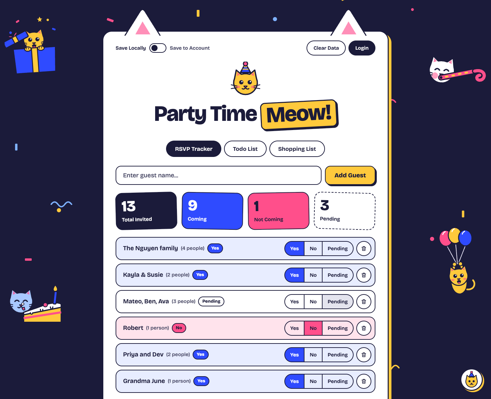

# 🎉 Party Cat

A simple party planning web app - running live at https://partycat.app



## ✨ Features
- **RSVP Tracker** - Manage guest lists with intelligent people count detection
- **Todo Management** - Track party planning tasks with completion status
- **Shopping Lists** - Organise items to buy with check-off functionality
- **Dual Mode Operation** - Works offline (localStorage) or online (accounts synced to a PHP + MySQL backend)
- **Intelligent Guest Detection** - Automatically counts guests
  - "Smith Family" → 4 people
  - "John & Jane" → 2 people
  - "Kate and Steve" → 2 people  
  - "Bob, Alice, Charlie" → 3 people

## 🚀 Development

### 1. Clone the Repository
```bash
git clone https://github.com/maevelander/partycat.git
cd partycat
```

### 2. Set Up the Backend
Guest mode works with no setup. Accounts (cloud sync) need PHP 8.1+ (production runs 8.5) and MySQL or MariaDB:

1. Create an empty database and run `schema.sql` against it
2. Copy `api/config-example.php` to `api/config.php` and fill in:
   - database credentials
   - your app URL (used in password reset links)
   - SMTP settings for a mailbox that sends password reset emails
   - the admin emails allowed to view analytics, and the timezone used to count visits per day

`api/config.php` holds secrets: it's gitignored, blocked from web access by `api/.htaccess`, and a local pre-commit hook refuses to commit it.
For local development, you can also add an `api/config.local.php` (same format, also gitignored). It takes precedence over `config.php`.

### 3. Run the Application
```bash
php -S localhost:8000
open http://localhost:8000
```

## 🧩 How the Backend Works

The frontend is static HTML, CSS and JavaScript. Account features talk to `api/index.php`, a small JSON API with no framework:

| Action | Method | What it does |
|---|---|---|
| `session` | GET | Returns the logged-in user, if any |
| `signup` / `login` / `logout` | POST | Account management (signup logs straight in) |
| `forgot_password` / `reset_password` | POST | Emails a one-hour reset link (`/?reset=<token>`) and sets the new password |
| `party` / `update_party` / `clear_party` | GET / POST | The user's party, its title, and Clear Data |
| `items` / `create_item` / `update_item` / `delete_item` | GET / POST | Guests, todos and shopping items (`type` = `guests`, `todos` or `shopping_items`) |
| `visit` | POST | Records an anonymous visit (once per browser per day; guests only after they click or type) |
| `stats` | GET | Guest, account and returning users for the last 30/60/90/180 days, plus daily counts (admin accounts only) |

Call it as `api/?action=<name>`; POST bodies are JSON.

**Security**
- Logins use an HttpOnly, SameSite=Lax session cookie backed by the `sessions` table (30 days). Passwords are hashed with PHP's `password_hash`.
- Every data query is scoped to the logged-in user's party, so users can only see and change their own data.
- POST requests must be JSON, which blocks cross-site form submissions (CSRF).
- Login, signup and password reset requests are rate limited per IP and per email address.

**Email**
- Password reset emails are sent over authenticated SMTP (PHPMailer, bundled in `api/lib/PHPMailer/`) from a mailbox on the app's own domain, so they pass SPF, DKIM and DMARC.

### Analytics Dashboard
Open `/analytics.html` and log in with an account listed in `admin_emails` in `api/config.php`. It shows, for the last 30, 60, 90 and 180 days:

- **Guest users**: browsers that used the app without logging in
- **Account users**: logged-in accounts, counted once across devices
- **Returning users**: people who used the app on more than one day

How it works: the app keeps a random ID in the browser's `localStorage` and sends a `visit` when someone uses it. Guests count only after their first click or keypress, so bots and drive-by page views don't count; logged-in users count when the app opens. The server stores at most one row per browser per day in the `visits` table, as a guest or account visit depending on the login. A browser that logs in counts only as an account visit that day. No cookies or third-party services are involved.

## 🌐 Deployment

partycat.app runs on shared PHP hosting. A deploy replaces the whole site, so upload all of these together:

- `index.html`, `about.html`, `legal.html`, `analytics.html`, `style.css`, and the whole `themes/` folder
- `api/index.php`, `api/.htaccess`, `api/config.php`, `api/lib/PHPMailer/`

Don't upload `api/config.local.php`, `schema.sql`, `CLAUDE.md` or other repo files. On the server, the app connects to MySQL at `127.0.0.1`.

## 🎨 Design Approach

- **Themes** - Four themes, switched with the cat button at the bottom right: Confetti (default), Astro Cat, Loose Thread and Calm Cat. The choice is saved in the browser (`partycat-theme` in `localStorage`)
- **Mobile-First** - Responsive design that works on all devices  
- **Progressive Enhancement** - Core functionality works without JavaScript
- **Accessibility** - Keyboard navigation and screen reader support

## 🤝 Contributing

1. Fork the repository
2. Create a feature branch (`git checkout -b feature/amazing-feature`)
3. Commit your changes (`git commit -m 'Add amazing feature'`)
4. Push to the branch (`git push origin feature/amazing-feature`)
5. Open a Pull Request

## 📄 License

This project is open source and available under the MIT License.